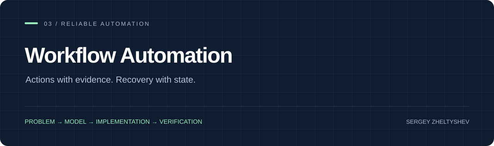

# Workflow Automation

A stateful automation system built around a simple rule: an action is complete only when its outcome has been reconciled with evidence.

[Case study](docs/case-study.md) · [System design](docs/system-design.md) · [Contracts](docs/contracts.md) · [Requirements & verification](docs/requirements.md)

[](https://github.com/SeregaObr882/workflow-automation/actions/workflows/ci.yml)

## Why this exists

Browser workflows outlive individual sessions. A timeout may happen before submission, after submission or during verification; blindly retrying the same step can duplicate an external action.

## What the system does

Persist process state in SQLite. Use bounded READ → SEMANTIC → APPLY/RECONCILE phases, validate decision evidence before building an action queue, and route unknown outcomes into reconciliation. The implementation applies this design to recruitment operations.

## Run the demonstration

```sh
python -m pip install -e ".[dev]"
python demo.py
python -m pytest -q
```

`output/workflow.json` shows the phase history, blocked action and recovered state. The demo uses a synthetic account, opens no browser and submits no external actions.

[Inspect the sample output](examples/expected-output.json).

## The result

The public offline scenario proves a durable review handoff, rejects execution with an empty approved queue and restores the same phase through a new orchestrator instance. The repository also includes contract tests for application queues, gateway behavior and candidate isolation.

## Engineering decisions

**SQLite owns the handoff.** A browser is a temporary executor. Durable state lets a later process resume without reconstructing decisions from chat history.

**Decision requires current evidence.** Source revision, profile/policy versions, exact vacancy fragments and verified candidate facts travel together. A score alone never authorizes an external action.

**Unknown outcome is a distinct state.** An uncertain submit does not become a failed submit eligible for a blind retry. The process enters reconciliation and waits for observable proof.

**Transactions and resources are explicit.** SQLite scopes commit or roll back atomically and explicitly close connections. This matters for repeatable cleanup and recovery on Windows as well as Linux.

## Repository map

```text
src/autohunt/business_batch.py  # Durable phase machine
src/autohunt/storage.py         # Schema evolution and evidence-gated read models
src/autohunt/decisions.py       # Revision-bound semantic decisions
src/autohunt/gateway.py         # Action boundary, attempts and proof
src/autohunt/context.py         # Candidate/account/policy context
src/autohunt/live_adapter.py    # Browser integration boundary
research_reference/            # Synthetic captured-surface fixtures
demo.py                        # Offline recovery walkthrough
```

## About this work

By **Sergey Zheltyshev — Systems Analyst & Software Engineer**. This repository connects problem framing, system contracts, implementation and verification. The public edition contains portable source and reproducible demonstration data; operational account material stays outside the release.

[Portfolio](https://github.com/SeregaObr882) · [License](LICENSE) · [Security](SECURITY.md)
