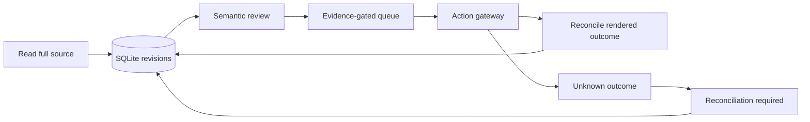

# System design

## System boundary

Persist process state in SQLite. Use bounded READ → SEMANTIC → APPLY/RECONCILE phases, validate decision evidence before building an action queue, and route unknown outcomes into reconciliation. The implementation applies this design to recruitment operations.

## Responsibility separation

**SQLite owns the handoff.** A browser is a temporary executor. Durable state lets a later process resume without reconstructing decisions from chat history.

**Decision requires current evidence.** Source revision, profile/policy versions, exact vacancy fragments and verified candidate facts travel together. A score alone never authorizes an external action.

**Unknown outcome is a distinct state.** An uncertain submit does not become a failed submit eligible for a blind retry. The process enters reconciliation and waits for observable proof.

**Transactions and resources are explicit.** SQLite scopes commit or roll back atomically and explicitly close connections. This matters for repeatable cleanup and recovery on Windows as well as Linux.

## Quality attributes

- **Traceability:** behavior is linked to explicit contracts and verification scenarios.
- **Reproducibility:** the default public scenario uses synthetic data and needs no private account.
- **Maintainability:** data boundaries, state transitions and presentation are separate concerns.
- **Failure visibility:** invalid or incomplete inputs retain an explicit error or review path.

These are design properties with concrete checks in [requirements](requirements.md); they do not stand in for deployment load tests or an external service SLA.

[Contracts](contracts.md) · [Case study](case-study.md)
